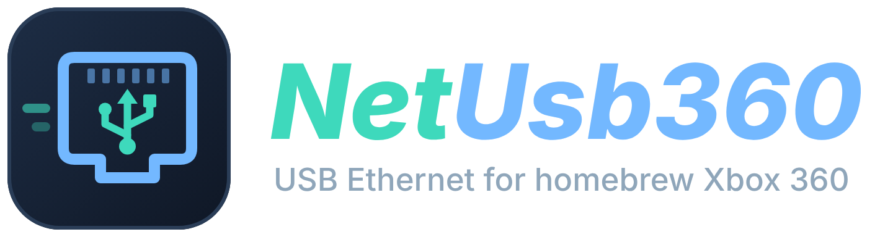
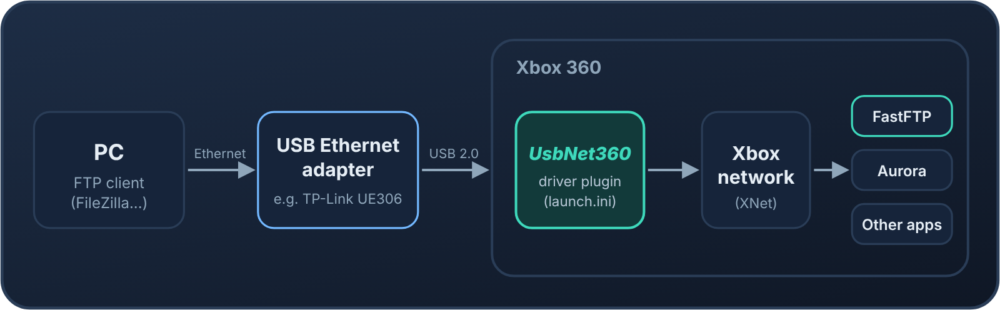
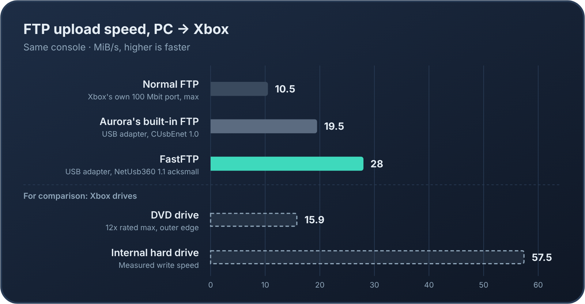

<p align="center">
  
</p>

<p align="center">
  <b>Use a USB Ethernet adapter as the network connection on a homebrew Xbox 360.</b>
  <br>
  <sub>A faster fork of <a href="https://github.com/proferabg/CUsbEnet">CUsbEnet</a> by proferabg. See <a href="#what-this-fork-changes">what this fork changes</a>.</sub>
</p>

<p align="center">
  
</p>

UsbNet360 is a driver plugin. Once it is loaded, a supported USB Ethernet adapter works like the console's own network port: Aurora, FTP servers, games and other apps use it without any changes.

Version 1.1 is tuned for speed. Together with **[FastFTP](https://github.com/marcusisdahl/Xbox360_FastFTP)**, it is the fastest way we know of to copy files to an Xbox 360 over FTP: about **28 MiB/s** measured on uploads, against about 19.5 MiB/s with Aurora's built-in FTP over the same adapter and about 10.5 MiB/s with normal FTP over the console's own 100 Mbit port.

<p align="center">
  
</p>

UsbNet360 is experimental kernel-level homebrew. Read [Safety](#safety) before you install it.

## What this fork changes

UsbNet360 starts from [CUsbEnet](https://github.com/proferabg/CUsbEnet) 1.0 by proferabg. CUsbEnet ports the USB Ethernet driver Microsoft shipped in early Xbox 360 development recoveries, and adds ASIX and Realtek chipsets to it. All of that work is proferabg's.

This fork, version 1.1, makes uploads to the Xbox about a third faster (27.66 MiB/s against 20.7 MiB/s):

- **Bigger receive transfers.** The AX88179 hands data over in 24 KiB USB transfers instead of 16 KiB.
- **Batched delivery.** Received packets go to the Xbox network stack in batches instead of one at a time.
- **The acksmall build.** Small packets, mostly TCP acknowledgements, share a USB transfer instead of each taking its own.
- **TP-Link UE300 support.** Its USB ID (`2357:0601`) is recognized as an RTL8153.
- **Test switches** for receive transfer sizes and for speed and CPU logging, all off by default. See [Build switches](#build-switches).

The plugin file is `UsbNet360.xex`. Coming from CUsbEnet? Put `UsbNet360.xex` in its place in `launch.ini`, and don't load both.

## Contents

- [What this fork changes](#what-this-fork-changes)
- [Quick start](#quick-start)
- [Which file to use](#which-file-to-use)
- [Supported adapters](#supported-adapters)
- [Use it with FastFTP](#use-it-with-fastftp)
- [Speed](#speed)
- [Troubleshooting](#troubleshooting)
- [Safety](#safety)
- [Build from source](#build-from-source)
- [Build switches](#build-switches)
- [Branches and history](#branches-and-history)
- [License and credits](#license-and-credits)

## Quick start

You need an Xbox 360 that runs homebrew plugins (RGH/JTAG with DashLaunch, or RGLoader) on dashboard/kernel **17559**, and a [supported adapter](#supported-adapters).

1. Download `UsbNet360.xex` from the [Releases page](https://github.com/marcusisdahl/UsbNet360/releases). See [Which file to use](#which-file-to-use) if you want the faster experimental build.
2. Copy it to the console, for example to `Hdd:\Plugins\UsbNet360.xex`.
3. Load it as the **first** plugin:
   - **DashLaunch:** in `launch.ini`, put it in `plugin1` and move your other plugins down, so it loads before `xbdm.xex`:

     ```ini
     [Plugins]
     plugin1 = Hdd:\Plugins\UsbNet360.xex
     plugin2 = Hdd:\Plugins\xbdm.xex
     ```

   - **RGLoader:** make it the first plugin entry in `rgloader.ini`.
4. Plug the adapter into a USB port on the Xbox, connect it to your router or switch with a network cable, and restart the console.
5. Aurora, FastFTP and your other apps now use the adapter. The IP address they show comes from your router as usual.

Keep a copy of your old `launch.ini` and driver so you can switch back.

Release 1.1 has the files under their old names, `CUsbEnet.xex` and `CUsbEnet-acksmall.xex`. They are the same driver: rename them, or use that name in `launch.ini`.

## Which file to use

Each release has two builds, both for a **retail** kernel 17559:

| File | What it is | Use it when |
|---|---|---|
| `UsbNet360.xex` | Standard build. All experimental options are off. | You want the safe choice. |
| `UsbNet360-acksmall.xex` | Adds **ACK batching**: small packets, mostly TCP acknowledgements, share a USB transfer instead of each taking their own. **Experimental.** | You have an original AX88179 adapter (such as the TP-Link UE306) and want the fastest uploads to the Xbox. |

The acksmall build reached 27.66 MiB/s from PC to Xbox with every byte checked. Long, unlimited transfers **from** the Xbox to a PC have not been fully checked yet, and a freeze was seen once in that direction. If your console freezes during downloads from the Xbox, go back to `UsbNet360.xex`.

## Supported adapters

The driver picks the chipset from the adapter's USB IDs, not its brand name. Check the chipset before you buy: adapters with the same name can use different chips in later revisions.

| Chipset | USB ID | Example adapters | Notes |
|---|---|---|---|
| ASIX AX88179 | `0B95:1790` rev 1 | **TP-Link UE306** | Used for all the speed results here |
| ASIX AX88179A / AX88179B | `0B95:1790` rev 2 | | |
| ASIX AX88772D | `0B95:1790` rev 3 | | |
| ASIX AX88279 | `0B95:1790` rev 4 | | |
| ASIX AX88178A | `0B95:178A` | | |
| ASIX AX88178 | `0B95:1780` | | The original devkit adapter chip |
| Realtek RTL8153 / RTL8153B | `0BDA:8153` | | Hardware versions 3–6 and 8–9 |
| Realtek RTL8153 | `2357:0601` | **TP-Link UE300** | New in 1.1 |

A USB 3.0 or gigabit adapter works, but the Xbox's USB 2.0 port sets the speed limit. In practice, about 28 MiB/s is the most this path delivers.

## Use it with FastFTP

[FastFTP](https://github.com/marcusisdahl/Xbox360_FastFTP) is an FTP server for the Xbox 360 made alongside this driver. It writes to the disk **while** the network transfer is still running, so it can keep up with what UsbNet360 delivers. Aurora's built-in FTP can't.

<p align="center">
  
</p>

1. Load UsbNet360 as described in [Quick start](#quick-start).
2. Start FastFTP from Aurora or your usual launcher (it's an app, not a plugin) and press **A** to start the server.
3. Connect from FileZilla or another FTP client to the IP address FastFTP shows, with user `xboxftp` and password `xboxftp`.

FastFTP's network test also shows whether the network, the disk or the FTP client is holding back your speed.

## Speed

All results are from one console uploading from PC to Xbox; the adapter rows use a TP-Link UE306:

| Setup | Speed |
|---|---|
| Normal FTP, Xbox's own 100 Mbit port (no adapter) | at most about 10.5 MiB/s |
| Aurora's built-in FTP, CUsbEnet 1.0 | about 19.5 MiB/s |
| FastFTP network test, CUsbEnet 1.0 | about 20.7 MiB/s |
| FastFTP network test, UsbNet360 1.1 acksmall, all data checked | **27.66 MiB/s** |
| FastFTP upload, UsbNet360 1.1 acksmall | **about 28 MiB/s** |

The maintainer has also seen up to 29 MiB/s FTP uploads with this combination.

For comparison, the console's internal hard drive writes at about 57.5 MiB/s (measured on the same console), so it is not the limit. The 12x DVD drive reads at most about 15.9 MiB/s (rated speed at the outer edge of the disc, not measured), so FastFTP over UsbNet360 copies faster than the console can read a disc.

What changed in 1.1:

- **Bigger receive transfers.** The AX88179 now hands data over in 24 KiB USB transfers instead of 16 KiB, the same as Linux uses on USB 2.0.
- **Batched delivery.** Received packets go to the network stack in batches instead of one at a time.
- **ACK batching** (acksmall build only). While uploading, the Xbox sends a stream of small acknowledgements, and each one used to cost a full USB transfer.

More streams, bigger socket buffers and even larger receive transfers made no real difference. At this point the driver uses about 15% of one CPU thread while receiving, so the limit is the Xbox's USB 2.0 controller and not the driver.

## Troubleshooting

| Problem | What to check |
|---|---|
| No network at all | Is `UsbNet360.xex` the **first** plugin? Is the adapter's chipset in the [table](#supported-adapters)? Try another USB port. |
| Nothing happens with a self-built XEX | A build made without `DEVKIT_ONLY=0` is for devkits only. It unloads itself on a retail console. See [Build from source](#build-from-source). |
| Slow transfers | Use a wired PC connection, not Wi-Fi. Run FastFTP's network test to see whether the network or the disk is the slow part. |
| Freeze while sending from the Xbox | Go back to the standard `UsbNet360.xex` and report it with your adapter and build. |

Driver log messages go to the debug output. You can read them with xbWatson when `xbdm.xex` is loaded.

## Safety

- UsbNet360 runs inside the Xbox kernel and uses fixed memory addresses for **dashboard 17559**. Don't use it on any other kernel.
- A driver bug can freeze the console. Keep your previous working setup so you can switch back.
- Installing the driver doesn't touch the NAND. To remove it, take it out of `launch.ini` or `rgloader.ini`.
- Before trusting a new or self-built build with your files, check it with FastFTP's network test using the **All data** check.

## Build from source

You need Visual Studio with the Xbox 360 SDK (XDK) integration and the `xkelib` submodule. The SDK isn't included.

```text
git clone --recurse-submodules https://github.com/marcusisdahl/UsbNet360.git
```

1. Open `CUsbEnet.sln` and select **Release | Xbox 360**.
2. For a retail console, add **`DEVKIT_ONLY=0`** to the C/C++ preprocessor definitions. Without it, `Main.h` builds for devkits.
3. The Release configuration copies the XEX to a configured console after building. Turn deployment off if you copy files yourself (`/p:DeploymentType=None` with MSBuild).
4. Build. The output is `Build\CUsbEnet\UsbNet360.xex`.

**Visual Studio 2022:** the xkelib step that generates `xamext.lib` and `kernelext.lib` may not run (link error LNK1181). Generate them once from `libraries\xkelib` with the XDK's `lib.exe`:

```text
lib /DEF:xamext21256.0.def /OUT:xamext.lib /MACHINE:PPCBE
lib /DEF:kernelext21256.0.def /OUT:kernelext.lib /MACHINE:PPCBE
```

## Build switches

These are compile-time options in `CUsbEnet/Main.h`. Every experimental switch is off by default.

| Switch | Default | What it does |
|---|---|---|
| `DEVKIT_ONLY` | `1` | `1` builds for devkit kernels and `0` for retail. A build for the wrong kind unloads itself. |
| `USBENET_AX88179_TX_AGGREGATION` | `0` | Lets the original AX88179 send several packets per USB transfer. **Don't use it alone**: it froze the console in testing. |
| `USBENET_COALESCE_TITLE_SMALL_FRAMES` | `0` | Lets small packets join a transfer already in progress. Part of acksmall. |
| `USBENET_TX_AGGREGATE_SMALL_ONLY` | `0` | Only packets up to 256 bytes share a transfer, and full-size packets still go one per transfer. Part of acksmall. |
| `USBENET_AX88179_RX_26K` | `0` | 26 KiB receive transfers on the AX88179. No measurable gain. |
| `USBENET_AX88179_RX_32K_UNTESTED` | `0` | 32 KiB receive transfers. Untested. Can't be combined with the 26 KiB switch. |
| `USBENET_PERF_LOGGING` | `0` | Prints a speed, CPU and drop summary every five seconds. |
| `USBENET_DEBUG` | `0` | Detailed driver output. Slows the driver down. |
| `USBENET_CONNECTION_LOGGING` | `0` | Extra connection diagnostics. |

The **acksmall** build is `DEVKIT_ONLY=0`, `USBENET_AX88179_TX_AGGREGATION=1`, `USBENET_COALESCE_TITLE_SMALL_FRAMES=1` and `USBENET_TX_AGGREGATE_SMALL_ONLY=1`.

## Branches and history

`main` holds the current driver, and [Releases](https://github.com/marcusisdahl/UsbNet360/releases) hold the builds. The 1.1 work came in through [PR #1](https://github.com/marcusisdahl/UsbNet360/pull/1) and a follow-up branch, and both are now merged.

These experiment branches were removed on 13 October 2026. You can restore one with `git push origin <commit>:refs/heads/<name>`:

| Former branch | Last commit | Why it was removed |
|---|---|---|
| `claude/project-thread-hy4q3s` | `4ffcef551ad9701abdb010364c3b1e46ca759035` | Fully merged into `main` |
| `claude/project-thread-0n0gng` (PR #1) | `69f23478e6dd9a7aac63c9adf22edab5cf21119f` | Fully merged into `main` |
| `experiment/usb2-tx-scheduler` | `cc34dcdb9a455f92f501e1cab861b4f135586f65` | Froze the console on Xbox → PC transfers. Replaced by the 1.1 send path. |
| `experiment/conservative-build-performance` | `63ffb57f22395f071a2f4b0544c1ef4c34e3a0ed` | Build settings only. Never tested on a console. |

## License and credits

UsbNet360 is licensed under the GNU General Public License, version 2 only (**GPL-2.0-only**), the same as CUsbEnet. See [LICENSE](LICENSE).

UsbNet360 is a fork of [proferabg/CUsbEnet](https://github.com/proferabg/CUsbEnet) by proferabg: a port of the USB Ethernet driver Microsoft shipped in early Xbox 360 development recoveries, with added chipset support. The driver's source files keep the CUsbEnet name. The `xkelib` submodule comes from proferabg's fork of xkelib. Hardware setup was developed with reference to the GPL-2.0 Linux USB Ethernet drivers, including `r8152`. Keep GPL notices, SPDX identifiers and attribution when you modify or redistribute the source.

This project is not affiliated with or endorsed by Microsoft, TP-Link, ASIX Electronics or Realtek Semiconductor.
